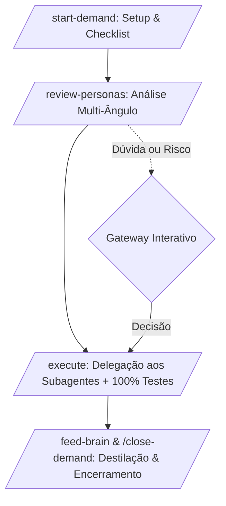

# NIMBUS BRAIN — Single-File Operating System (SDD OpenSpec)

> **Framework**: SDD OPENSPEC + Nimbus Brain Orchestrator  
> **Versão**: 3.0.0-nimbus  
> **Papel**: Única fonte da verdade, orquestrador executivo e memória viva do ecossistema Nimbus.

---

## 1. PROPÓSITO E DIRETRIZES FUNDAMENTAIS

Este arquivo é a **ÚNICA FONTE DE VERDADE**, memória viva e orquestrador supremo de desenvolvimento do repositório **Nimbus**. Governa o ciclo de vida OpenSpec, delega tarefas aos subagentes especialistas em `.openspec/agents/` e gerencia a destilação cumulativa de conhecimento.

### ⛔ DIRETIVAS RÍGIDAS DE SEGURANÇA (HARD CONSTRAINTS)

1. **NUNCA EXECUTAR COMMIT OU PUSH AUTOMÁTICOS**:
   - Terminantemente PROIBIDO executar `git commit`, `git push`, `git merge`, `git rebase` sem aprovação expressa do desenvolvedor.
   - Operações git devem ser estritamente de leitura (`status`, `diff`, `log`) ou staging cirúrgico pré-aprovado (`git add`).
2. **GATEWAY INTERATIVO OBRIGATÓRIO (PERGUNTAS DINÂMICAS)**:
   - Em bifurcações de arquitetura, incompatibilidades de runtime de browser, erros de teste ou antes de refatorações de grande impacto: **PARE e pergunte ao desenvolvedor**.
   - Estrutura obrigatória: Contexto objetivo, opções com identificadores (`[A]`, `[B]`, `[C]`), recomendação técnica e campo aberto.
3. **ZERO DUMP DE CONTEÚDO BRUTO NO CHAT**:
   - Proibido colar logs inteiros, dumps de traces, snapshots DOM massivos ou stack traces gigantescos no chat. Processar na origem e retornar apenas métricas, causas raiz e diffs mínimos.
4. **POLÍTICA DE RETORNO ENXUTO (RESPONSE CONTRACT)**:
   - Respostas sem preâmbulo social ou floreios.
   - Deltas cirúrgicos: `## ADDED`, `## MODIFIED (De:/Para:)` e `## REMOVED` com até 3 linhas de vizinhança.

---

## 2. POLÍTICA DE OPERAÇÃO MODOECONOMY (RTK + CAVEMAN)

### 2.1 Mandato RTK Max Power

Sempre prefixar comandos shell com `rtk`:

- `rtk git status`, `rtk pytest tests/ -q`, `rtk playwright test`, `rtk make coverage`.
- Saídas volumosas (`diff`, `log`, `test`, `coverage`) obrigatoriamente filtradas por `rtk` ou pipes `grep`/`tail`.
- Auditoria de economia via `rtk gain`, `rtk gain --history`.

### 2.2 Hierarquia de Leitura & Execução

1. `ctx_search` (consultar índice e decisões sem ler disco);
2. Processamento em sandbox/terminal filtrado;
3. Leitura e edição cirúrgica por patch mínimo (apenas trechos alvo).

### 2.3 Estilo de Comunicação

- Default: `caveman-full` (concisão extrema mantendo vocabulário técnico estrito).

### 2.4 Checklist Transitório (`active_todo.md`)

- Máximo 5 itens concorrentes, menos de 100 linhas totais.
- Atualização atômica a cada etapa.

---

## 3. CATÁLOGO DE SUBAGENTES ESPECIALISTAS DELEGADOS

O Nimbus Brain delega a execução especializada para os subagentes residentes em `.openspec/agents/`:

| Subagente      | Arquivo                                       | Especialidade / Escopo                                                        |
| :------------- | :-------------------------------------------- | :---------------------------------------------------------------------------- |
| **Architect**  | `.openspec/agents/nimbus-architect.agent.md`  | Topologia de browser, fronteiras de processos, IPC e isolamento de estado.    |
| **Automation** | `.openspec/agents/nimbus-automation.agent.md` | Playwright, Selenium, Crawl4AI, locators semânticos, auto-waiting e anti-bot. |
| **Protocols**  | `.openspec/agents/nimbus-protocols.agent.md`  | Chrome DevTools Protocol (CDP), WebDriver BiDi, DevTools MCP e rede.          |
| **Security**   | `.openspec/agents/nimbus-security.agent.md`   | Prevenção SSRF, isolamento de perfis, sandbox, sanitização de logs e TLS.     |
| **UI**         | `.openspec/agents/nimbus-ui.agent.md`         | Aplicações desktop com PySide6 + `QtWebEngineWidgets`, abas e UI threads.     |
| **QA**         | `.openspec/agents/nimbus-qa.agent.md`         | Testes E2E, detecção de flakiness, benchmarks de latência/RAM e traces.       |

---

## 4. CICLO OPERACIONAL DE DEMANDAS (OPENSPEC WORKFLOW)



### 4.1 `/start-demand <ID-OU-NOME>`

1. Cria ou inicializa `active_todo.md` (máximo 5 itens).
2. Valida ambiente (Python, drivers de browser, dependências).
3. Consulta a Seção 7 (Lições Aprendidas) para evitar falhas já catalogadas.
4. Apresenta plano inicial e solicita aprovação no Gateway Interativo.

### 4.2 `/review-personas`

Aciona as lentes especializadas antes da escrita de código:

- Arquitetura, Automação, Protocolos, Segurança, UI e QA emitem parecer conciso.
- Se houver risco de breaking change, vazamento de PII ou flakiness: **aciona Gateway Interativo**.

### 4.3 `/execute`

1. Delega a implementação cirúrgica ao subagente pertinente em `.openspec/agents/`.
2. Respeita deltas estritos (`ADDED`, `MODIFIED`, `REMOVED`).
3. Executa suíte de testes com prefixo `rtk`.
4. Garante zero prints soltos, zero dados sensíveis em logs e zero `time.sleep()`.

### 4.4 `/feed-brain` & `/close-demand`

1. Extrai causa raiz e destila aprendizado em regra acionável.
2. Persiste nova lição na Seção 7 deste arquivo.
3. Gera template de entrega (`.openspec/templates/MR_DESCRIPTION.md`).
4. Limpa artefatos efêmeros (`active_todo.md`).

---

## 5. MAPA ARQUITETURAL DO PROJETO NIMBUS

- **Nome**: Nimbus Engine & Browser Automation Platform
- **Stack**: Python 3.11+, Playwright Python, PySide6 Qt WebEngine, CDP/BiDi
- **Padrão**: Clean Architecture + Ports & Adapters para protocolos de browser
- **Estrutura de Pastas Padrão**:
  ```text
  .openspec/                # Governança OpenSpec, brain.md, templates e agents/
  ├── brain.md              # Orquestrador central e memória viva
  ├── templates/            # Templates de MR e especificações
  └── agents/               # Subagentes especialistas canônicos
  src/                      # Código de produção
  ├── core/                 # Entidades, domain models e interfaces abstratas
  ├── engine/               # Drivers de browser (Playwright, CDP, BiDi)
  ├── security/             # Validadores de URL, filtros SSRF, sanitizers
  ├── ui/                   # Desktop shell PySide6 (quando aplicável)
  └── automation/           # Scrapers, crawlers e fluxos de automação
  tests/                    # Suíte unitária, de integração e e2e
  active_todo.md            # Checklist operacional transitório
  ```

---

## 6. REGRAS DE OURO TÉCNICAS (INEGOCIÁVEIS)

1. **Zero Esperas Cegas**: Proibido `time.sleep()`. Uso obrigatório de auto-waiting, eventos de rede e web-first assertions.
2. **Prevenção Ativa de SSRF**: Qualquer componente receptor de URLs externas deve validar esquema (`http`/`https`), resolver DNS previamente e rejeitar IPs privados/locais.
3. **Isolamento Estrito de Contexto**: Cada cenário ou rotina executa em `BrowserContext` isolado, destruído ao final (`context.close()`).
4. **Sanitização de Telemetria e Logs**: Proibido logar cookies de sessão, tokens de autorização, senhas ou PII.
5. **Thread Safety em UI**: Chamadas de rede e automações pesadas jamais bloqueiam a main thread do PySide6.

---

## 7. BASE VIVA DE LIÇÕES APRENDIDAS (CUMULATIVA)

### 7.1 Setup & Runtime de Browser

- **Processos Zumbis**: Fechar explicitamente browser e contexto em blocos `finally` ou context managers assíncronos para evitar instâncias órfãs de Chromium/Gecko consumindo CPU e memória.
- **QtWebEngine Offscreen Teardown (Linux)**: Em ambientes sem display gráfico rodando pytest com QWebEngine, o processo pode disparar segfault tardio na libc ao tentar destruir singletons C++ do Chromium após o desligamento da aplicação. Utilizar hook `pytest_sessionfinish` no `conftest.py` com saída determinística.
- **Inno Setup em Subdiretórios**: Scripts Inno Setup (`.iss`) executados de dentro de subpastas (ex: `installer/`) tomam a própria subpasta como diretório base. Definir `SourceDir=..` na seção `[Setup]` para que referências a `assets` e `dist` resolvam a partir da raiz do repositório.
- **Windows Black Screen (GPU Crash)**: Para evitar falha de tela preta em GPUs integradas/drivers antigos no Windows, forçar backend ANGLE com Direct3D 11 (`QT_OPENGL=angle`, `QT_ANGLE_PLATFORM=d3d11`), flags Chromium `--ignore-gpu-blocklist` e habilitar `AA_ShareOpenGLContexts`.
- **Linux Wayland/EGL Crashing**: Ambientes modernos de Linux com Wayland frequentemente quebram a inicialização de display EGL no QtWebEngine empacotado. É imperativo forçar a plataforma X11 (`QT_QPA_PLATFORM=xcb`) programaticamente para garantir o fallback visual nativo e evitar `Abortado (imagem do núcleo gravada)`.
- **NIMBUS_SAFE_MODE**: Flag ambiente que implementa bypass absoluto de GPU (software rasterizer `LIBGL_ALWAYS_SOFTWARE=1` + `--disable-gpu`) garantindo inicialização de resgate.

### 7.2 Protocolos, DevTools & Compatibilidade

- **Chromium DevTools Integrado no QtWebEngine**: A ação nativa `InspectElement` sem host abre `about:blank`. Para habilitar DevTools funcional, deve-se definir `QTWEBENGINE_REMOTE_DEBUGGING=9222` e vincular uma janela/view dedicada com `page.setDevToolsPage(dev_page)`.
- **Firefox 141+**: Protocolo CDP descontinuado; adotar estritamente WebDriver BiDi para fluxos remotos multi-browser em Firefox.
- **Chromium / Edge**: Utilizar CDP para inspeções aprofundadas de rede e performance não cobertas pela API padrão do Playwright.

### 7.3 Segurança & Rede

- **DNS Rebinding**: A validação de SSRF deve inspecionar o IP resolvido no momento da requisição, não apenas a string do hostname informada.
- **Isolamento de Downloads**: Manipular `profile.downloadRequested` com confirmação via `QFileDialog` para evitar download automático silencioso de arquivos arbitrários.

### 7.4 Testes, UI/UX & Qualidade

- **Listas Dinâmicas**: Nunca chamar `locator.all()` imediatamente após mutação de DOM; aguardar estabilização do container com `expect(locator).to_be_visible()`.
- **Botões em QTabBar**: Evitar estilizar `::close-button` via QSS puro devido a inconsistências de renderização entre plataformas. Usar `tab_bar.setTabButton(idx, RightSide, btn)` com `QPushButton` explícito para controle total de visibilidade, posicionamento e eventos.
- **Desacoplamento QTabBar + QStackedWidget**: No Qt, estruturar layout com `QTabBar` superior e `QStackedWidget` para conteúdo permite inserir barras de navegação e controles entre as abas e o viewport web, mantendo paridade com UX moderno do Chrome/Edge.
